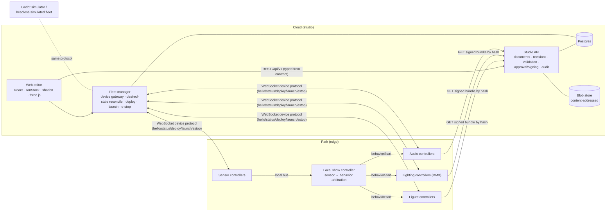

# Architecture

## Principles

1. **Authoring happens in the cloud; shows run at the edge.** The cloud designs, validates, signs and distributes. Nothing in the cloud is in the real-time loop: a launched show and its sensor reactions run entirely in the park.
2. **One contract, many implementations.** Data model, REST API, device protocol and playback semantics are defined once ([contract.md](contract.md)) and enforced at runtime and in CI.
3. **Defense in depth for motion safety.** The editor validates live, the API re-validates before publishing, a second person approves and signs, each device re-validates against limits it holds itself, and the hard-wired safety circuit sits outside all software.
4. **Immutable, content-addressed artifacts.** Revisions and bundles never change; approval binds to a hash; rollback means deploying an older hash.

## Components

| Component                  | Code                | Notes                                                                                           |
| -------------------------- | ------------------- | ----------------------------------------------------------------------------------------------- |
| Contract package           | `packages/schema`   | zod → TS types, JSON Schema, OpenAPI, AsyncAPI                                                  |
| Playback package           | `packages/playback` | Interpolation, validation, compiler, deterministic runtime; runs in browser, server and devices |
| Studio API + fleet manager | `apps/api`          | Fastify 5 on Bun; one deployable now, split along the service boundary when scale requires      |
| Web editor                 | `apps/editor`       | Vite, React 19, TanStack Router/Query/Table/Form/Store, shadcn/ui (Radix), react-three-fiber    |
| Simulated attraction       | `apps/fleet-sim`    | Headless reference device implementation; used by the API end-to-end tests                      |
| Godot simulator            | `apps/godot-sim`    | Game-engine twin of an attraction: same protocol and playback, renders the show, walkable guest |

## Key flows

**Author → approve.** Engineer edits a draft (autosave, optimistic concurrency, undo history) → live validation in the browser → publish: server re-validates with the same code, freezes the revision, compiles the bundle (deterministic) → safety reviewer (not the author) approves → server signs the bundle bytes.

**Deploy → good to go.** Operator deploys an approved revision → all-or-nothing pre-check (every device online, right kind, running the pinned definition) → desired state recorded → gateway sends `deploy` → each device downloads, verifies hash + signature + schema, re-validates against its own limits, fetches and verifies audio, writes atomically, reports `staged` → deployment is **good to go** when every target reports the same verified hash.

**Launch → run.** Operator confirms the zone is clear → `launch {startAt = now + lead}` to every device → each converts to its local clock and starts together → plays from the local copy. Sensor events go to the park-local show controller, which decides (window, cooldown, no overlap per device) and broadcasts the start time. The cloud can disappear mid-show.

**E-stop.** Any signed-in user; the command goes to devices _before_ any bookkeeping; latched in the database and re-sent to devices that reconnect; only an operator can reset. Software e-stop complements, never replaces, the hard-wired safety circuit.

## Assumptions

- One company, several parks; tens of attractions per park; ~5–50 devices per attraction; figures with 5–100 joints.
- Show data is small (100 joints × 100 Hz × 4 B × 10 min ≈ 24 MB raw, far less as keyframes); 3D models and audio dominate storage.
- Controllers expose a networked interface (Ethernet, on a segmented show-control network) and hold their own limits. Real-time motion control (1 kHz loops, EtherCAT/CAN) stays on the controller. The bundle provides keyframes, and the controller interpolates them.
- Time sync on site via PTP/SMPTE; the prototype derives clock offset from `welcome.serverTime`.
- Lighting fixtures are addressed via DMX universe/address; the fixture controller maps color/intensity to channels.

## Scaling path

Stateless API instances behind a load balancer; device gateway sharded by attraction with a pub/sub fan-out (or an MQTT broker such as EMQX / AWS IoT Core); a per-park edge gateway that caches bundles so devices never depend on the internet; S3/GCS + CDN for blobs; Postgres managed with read replicas. See [PRODUCTION_READINESS.md](../PRODUCTION_READINESS.md).
