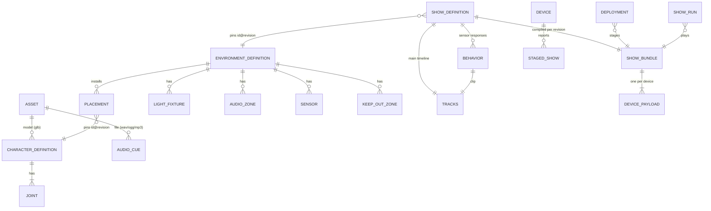
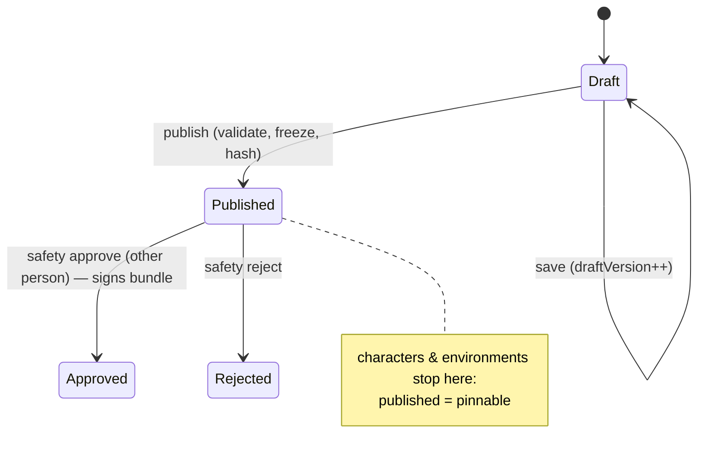
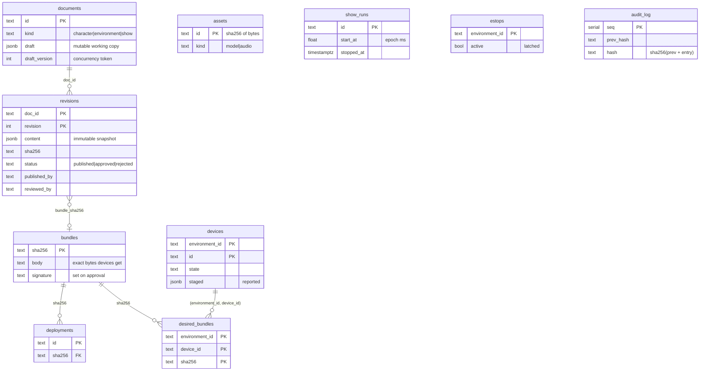
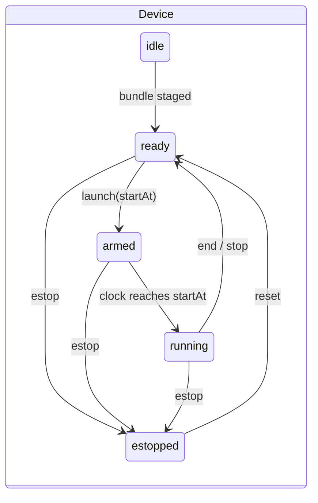

# Data model

Single source of truth: [`packages/schema`](../packages/schema/src). Every type below is a zod schema there; JSON Schema copies live in [`contracts/json-schema`](../contracts/json-schema) for non-TypeScript consumers (game engine, controller firmware).

## Conventions

| Quantity          | Unit / convention                                                        |
| ----------------- | ------------------------------------------------------------------------ |
| Length, position  | meters, Y-up, right-handed (glTF)                                        |
| Revolute joints   | degrees; velocity in °/s                                                 |
| Prismatic joints  | meters; velocity in m/s                                                  |
| Time in shows     | integer milliseconds from show (or clip) start                           |
| Wall-clock time   | epoch ms (fleet clock) on the wire, ISO-8601 in REST                     |
| Audio level       | dBFS (0 = full scale, always ≤ 0)                                        |
| Color             | `#rrggbb` + intensity 0..1 (DMX mapping is the fixture controller's job) |
| Ids               | `^[a-z0-9][a-z0-9_-]{0,63}$`, stable, human-readable                     |
| Content addresses | lowercase SHA-256 hex of the exact bytes                                 |

## Domain model



| Entity                         | What it is                                                                                                                                                                                     | Key rules                                                                                                                            |
| ------------------------------ | ---------------------------------------------------------------------------------------------------------------------------------------------------------------------------------------------- | ------------------------------------------------------------------------------------------------------------------------------------ |
| **CharacterDefinition**        | Digital twin of a physical figure: GLB model, footprint, joints (`node`, `axis`, `min/max`, `home`, `maxVelocity`).                                                                            | Joints are bound to glTF node names. `home ∈ [min, max]`. Footprint = bounding box of the full range of motion.                      |
| **EnvironmentDefinition**      | One attraction: stage box, keep-out zones, ambient, palette, and every device: placements (figures), light fixtures (DMX universe/address), audio zones (dBFS ceiling), sensors (type, range). | Device ids unique across the attraction. Footprints inside the stage, never intersecting keep-out zones.                             |
| **ShowDefinition**             | A timeline for one environment revision: `tracks` (motion per figure/joint, light keys per fixture, audio cues per zone) and `behaviors`.                                                      | Keys strictly ordered, inside the duration, within limits; speeds ≤ `maxVelocity` including the move from home; cues ≤ zone ceiling. |
| **Behavior** (sensor response) | Trigger (`sensorId` + event), optional show-time window, `blendMs`, `cooldownMs`, and a short clip (its own `Tracks`).                                                                         | Bounded clips, not scripts: blend in from _any_ pose and back, so the validator can prove safety.                                    |
| **ShowBundle**                 | Compiled, per-device artifact the fleet ships.                                                                                                                                                 | Deterministic; content-addressed; signed on approval.                                                                                |

### Tracks and interpolation

```
Tracks = { motion:  deviceId -> joint -> MotionKey[]   (t, v, interp)
           lights:  deviceId -> LightKey[]             (t, color, intensity, interp)
           audio:   deviceId -> AudioCue[] }           (id, t, assetId, volumeDb, label)
```

`interp` shapes the segment _from_ a key to the next: `linear`, `ease` (smoothstep `3u²−2u³`, peak speed 1.5× linear, never overshoots) or `step`. Before its first key a joint starts from `home` (implicit linear key at t=0); a light starts off. After the last key every track holds. The exact rules are pinned by [`test-vectors/playback.json`](../test-vectors/playback.json); every playback implementation must reproduce them.

### Sensor responses (behaviors)

Local time from trigger: `[0, blend)` blend from the pose at trigger time to the clip's first value (clip clock held) → `[blend, blend+dur)` clip → `[blend+dur, 2·blend+dur)` blend to where the main timeline will be at the end. Scheduling is deterministic: trigger + event match, inside window, past cooldown (measured from the end of the previous run), and no running behavior shares a device. The park-local show controller arbitrates and broadcasts decisions so devices agree.

Validation proves the blend is safe from _anywhere_: `1.5 · max(|start − min|, |max − start|) / blend ≤ maxVelocity` (same for the clip end). A property test checks the sampled trajectory never exceeds `maxVelocity`.

## Versioning and immutability



| Thing     | Scheme                                                 | Rule                                                                                                   |
| --------- | ------------------------------------------------------ | ------------------------------------------------------------------------------------------------------ |
| Draft     | `draftVersion` integer                                 | Optimistic concurrency: save with a stale version → `409`. Publish names the version reviewed.         |
| Revision  | `docId@N`, immutable, `sha256` of canonical content    | Publishing identical content → `409 No changes`. Any later edit is a new revision.                     |
| Reference | `DocRef {id, revision}`                                | Environments pin character revisions, shows pin environment revisions. Re-pinning is an explicit edit. |
| Approval  | bound to a revision **and** its bundle hash            | Editing after approval creates a new revision that needs approval again. Author ≠ reviewer.            |
| Bundle    | `sha256` of canonical JSON bytes, RSA-SHA256 signature | Byte-identical for identical inputs (no timestamps) → reproducible. Devices verify both.               |
| Schema    | `schemaVersion: 1` in every document/bundle            | Consumers reject unknown versions.                                                                     |
| Protocol  | `protocolVersion` in `hello`                           | Gateway rejects incompatible devices (close code 4003).                                                |
| API       | `/api/v1`                                              | Breaking change → `/api/v2`; contract tests catch accidental drift.                                    |
| Database  | forward-only migrations                                | Never edit a shipped migration.                                                                        |

## Persistence (Postgres)

Source: [`apps/api/src/db/migrations.ts`](../apps/api/src/db/migrations.ts). Same SQL runs on PGlite (dev/tests) and Postgres (compose/production).



- **Desired vs reported state.** `desired_bundles` is what each device _should_ hold; `devices.staged` is what it _says_ it holds. The gateway reconciles on every heartbeat (deploy missing, remove unwanted, re-send a latched e-stop, stop a run that was stopped while the device was offline).
- **Blobs** (models, audio) are content-addressed files behind a `BlobStore` interface (filesystem now, S3/GCS in production).
- **Audit log** is append-only and hash-chained; `GET /api/v1/audit/verify` detects any edited or deleted row.

## Runtime state machines



Per staged bundle: `downloading → staged | rejected(reason)`. Rejection reasons are explicit: `hash mismatch`, `invalid signature`, `bundle does not match schema version 1`, `definition mismatch`, `limit check failed: …`, `audio asset … corrupted`.
