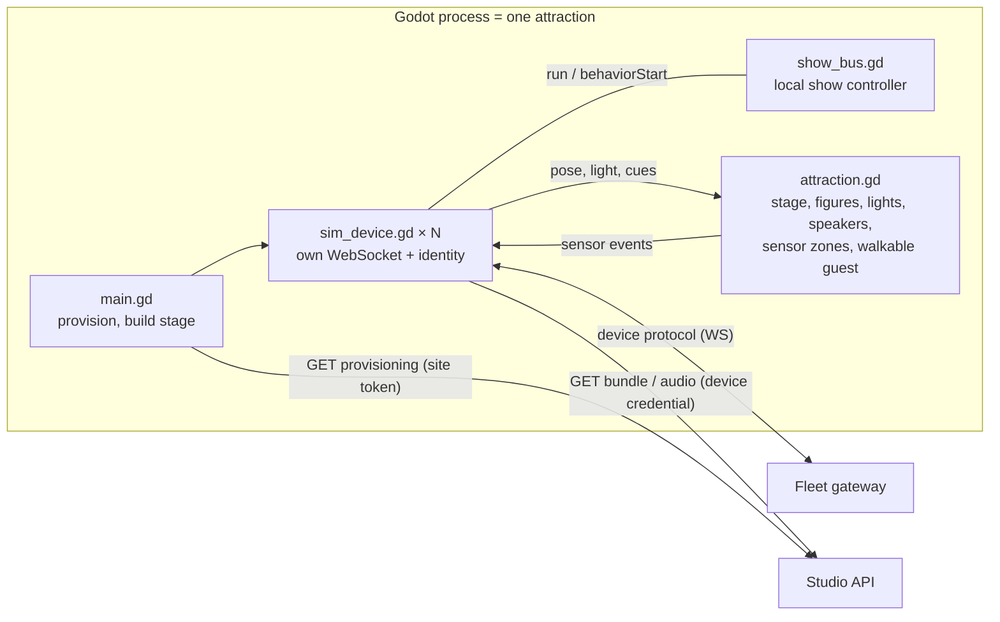

# Game-engine simulator (Godot)

The engine simulator is just another attraction: it implements the device protocol and the playback spec, so the studio provisions, deploys to and launches it exactly as it would a park. It lives in [`apps/godot-sim`](../apps/godot-sim) (Godot 4.7, GDScript, no add-ons). The Node fleet in [`apps/fleet-sim`](../apps/fleet-sim/src) is the reference it was ported from, one file at a time.

```bash
bun run dev && bun run seed       # studio + demo content
bun run sim:godot                 # the attraction in a window (instead of bun run fleet-sim)
bun run sim:godot --headless      # same, no window
bun run test:godot                # conformance vectors in Godot
bun run e2e:godot                 # fresh studio + Godot: deploy -> launch -> sensor -> e-stop
```

Godot is found via `$GODOT`, `godot`/`godot4` on `PATH`, or `/Applications/Godot.app`. Simulator options go after the engine flags: `--api`, `--env`, `--token` (provisioning), `--data` (local show store, default `user://fleet`), `--corrupt <device>` and `--outdated-firmware <device>` (fault injection, same as the Node fleet), `--screenshot out-%d.png --screenshot-delay 5,12`.

Run one fleet per attraction. If the Node fleet and Godot both connect, the newer connection takes over each device id (close code `4005`) and the older one stops reconnecting instead of fighting over it.

## What it does



1. **Provision.** `GET /api/v1/fleet/provisioning/{environmentId}` with `x-provisioning-token` returns the device ids, kinds and credentials, the pinned character definitions, the signing public key and the **layout** (the attraction's `EnvironmentDefinition`). One `sim_device.gd` per device, plus one local show controller.
2. **Build the stage** from the layout: stage boundary, keep-out zones, figures, spot lights (aimed at their targets), speakers, sensor zones and a guest you can walk around. Figure GLBs come from `/api/v1/assets/{assetId}` with a device credential and are checked against their content hash.
3. **Connect.** WebSocket `/api/v1/devices/ws`: `hello`, then `welcome` (clock offset = `serverTime − now`), then `status` every `heartbeatMs`. Reconnects with backoff. Every incoming message is validated against `FleetToDevice` in the published JSON Schema before it is acted on.
4. **Deploy.** Download the bundle, check `sha256`, verify the RSA-SHA256 signature with the pinned key, validate it against [`contracts/json-schema/ShowBundle.json`](../contracts/json-schema/ShowBundle.json), check that this device's payload exists, is the right kind and pins the definition the controller runs, re-validate motion against the controller's **own** limits, and fetch and verify the audio. Write it atomically, then report `staged`. Any failure is reported as `rejected` with the reason.
5. **Launch.** Start at `startAt − offset` and sample the runtime every frame from the local copy; the cloud can disappear mid-show. `stop` returns to ready; `estop` latches until `reset`. Audio controllers clamp every cue to their own ceiling.
6. **Sensors.** Walking the guest into a presence zone (WASD), clicking a sensor, the number keys, or the studio's "Simulate guest" button all fire the sensor's controller. Its event goes to the local show controller, which runs the scheduler and broadcasts `behaviorStart` to the devices involved. The cloud only gets `sensorEvent` telemetry.

| File                                                            | Ported from                                          | Role                                                           |
| --------------------------------------------------------------- | ---------------------------------------------------- | -------------------------------------------------------------- |
| `scripts/playback.gd`                                           | `packages/playback/src/interpolate.ts`, `runtime.ts` | Interpolation, behaviors, audio cues, frame sampling           |
| `scripts/scheduler.gd`                                          | `BehaviorScheduler`                                  | Sensor arbitration (window, cooldown, one behavior per device) |
| `scripts/validator.gd`                                          | `validateDollPayload`                                | Device-side limit check                                        |
| `scripts/json_schema.gd`                                        | zod parsing                                          | Validates bundles and messages against `contracts/json-schema` |
| `scripts/sim_device.gd`                                         | `apps/fleet-sim/src/device.ts`                       | Protocol, staging, playback state machine                      |
| `scripts/show_bus.gd`                                           | `apps/fleet-sim/src/bus.ts`                          | Park-local network + show controller                           |
| `scripts/figure.gd`                                             | editor `character-model.tsx`                         | Runtime GLB load, joint binding, posing                        |
| `scripts/attraction.gd`, `hud.gd`, `orbit_camera.gd`, `main.gd` | editor `stage-scene.tsx`                             | Stage, overlay, camera, wiring                                 |

## How we know it matches

- **Conformance vectors** ([`test-vectors/`](../test-vectors)) are generated from the TypeScript implementation and replayed by [`tests/run_tests.gd`](../apps/godot-sim/tests/run_tests.gd): motion and light sampling, whole-show frames with a sensor response, audio cue timing, scheduler decisions, the device-side limit check (which error codes each bad payload raises), RSA signature interop, and JSON Schema validation of bundles and fleet messages. A mutation check (breaking the easing or the range check) makes the suite fail.
- **End to end** ([`scripts/godot-e2e.ts`](../scripts/godot-e2e.ts)): a fresh studio and seed, Godot headless as the attraction, then through the public API: nine controllers online, deploy and good to go, launch and running, figures moving, cues playing, the door sensor starting `notice-guest` locally, e-stop latched, reset. Both run in CI (`godot` job).

## Pose application

For each joint: reset the node to its rest transform, then for `revolute` post-multiply the rest rotation by `Quaternion(normalize(axis), radians(v))`; for `prismatic` translate by `restRotation · axis · v`. Joints sharing a node apply in definition order. glTF is Y-up and right-handed, like Godot and three.js, so no conversion is needed. Nodes are found by their glTF name, after Godot's `validate_node_name()`. Godot keeps those names on generated nodes, while `GLTFState.get_scene_node()` is not usable after `generate_scene()`.

## Runtime (must match `packages/playback/src/runtime.ts`)

- Segment shape by the earlier key's `interp`: linear `u`, ease `3u²−2u³`, step `0` until the next key.
- Motion before the first key starts from `home` (implicit linear key at t=0); lights before the first key are off; everything holds after the last key.
- Behavior with blend `b` and clip duration `d`, started at `s`: local `l = t − s`;
  `l < b` → `lerp(base(s), clip(0), ease(l/b))`; `l < b+d` → `clip(l − b)`; `l < 2b+d` → `lerp(clip(d), base(s+2b+d), ease((l−b−d)/b))`; otherwise `base(t)`.
- Audio cues fire when their time is crossed: timeline cues at `cue.t`, behavior cues at `s + b + cue.t`, ordered by time (stable). Level is `volumeDb` dBFS; Godot's `volume_db` takes it directly.

## Engine notes

- Godot connects to the first address a host name resolves to (`::1` for `localhost` on macOS) while the studio listens on IPv4, so the simulator rewrites `localhost` to `127.0.0.1`.
- `HTTPRequest`, `WebSocketPeer`, `HashingContext`, `Crypto.verify` (RSA PKCS#1 v1.5 with an SPKI PEM key), `GLTFDocument` and `AudioStreamWAV/OggVorbis.load_from_buffer` cover everything natively; no add-ons, no import step (scripts are wired with `preload`, so the project runs straight from a clean checkout).
- The game engine is a visual and protocol twin, not a dynamics model: it plays the same keyframes as the controllers but does not simulate motors, inertia or collisions (see [PRODUCTION_READINESS.md](../PRODUCTION_READINESS.md)).
